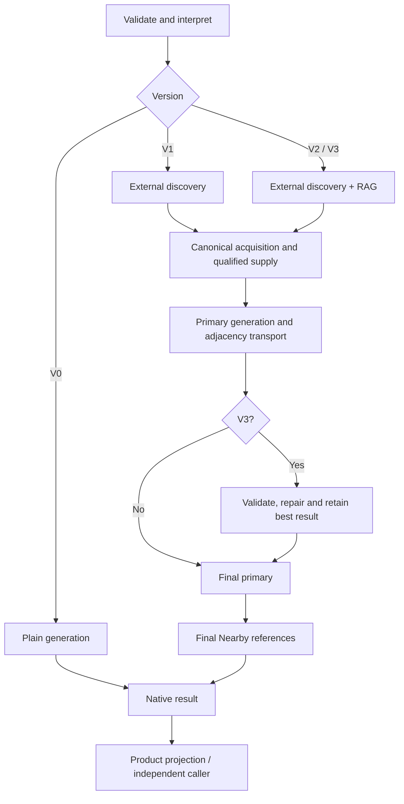

# System architecture

Dayloom is a modular monolith: a React interface, a FastAPI application and a
Python planning backend, backed by PostgreSQL with pgvector. Product exposes V3;
command-line and programmatic interfaces also run V0–V2 independently.

## Responsibility boundaries

| Layer | Responsibility |
| --- | --- |
| React | Brief editing, account interaction, progress observation and presentation |
| FastAPI and application services | Validation, authentication, durable tasks, persistence and public projections |
| Planning backend | Interpretation, acquisition, retrieval, generation, validation and Repair |
| Provider adapters | Bounded external calls and normalization into internal evidence schemas |
| PostgreSQL | TripWorld retrieval in `tripworld`; Product lifecycle in `app` |
| RTPEval | Independent assessment of selected, source-bound outputs |

LangGraph coordinates stages through services and clients. Both database schemas
share one database. No separate queue, cache service or microservice layer is used.

## Version mechanisms

| Version | Added mechanism |
| --- | --- |
| V0 | Shared interpretation, plain generation, estimated transport and model-knowledge references |
| V1 | External evidence, canonical qualified supply and post-primary Nearby |
| V2 | V1 plus TripWorld retrieval, Google identity resolution and canonical merging |
| V3 | V2 plus structured validation, authorized Repair and re-validation |

V1–V3 share a tools graph with explicit discovery and post-primary extension hooks.
V0 retains its own graph and acquires no external travel evidence. Repair does not
rerun interpretation or primary generation.

## Request flow

Input gates precede lazy provider/retrieval initialization. Discovery origins share
canonical capacity without duplicate rewards. Nearby cannot change the final primary.

## Model identity references

Structured model calls use deterministic, request-local aliases such as `p1`, `a1`
and `r1` over complete canonical IDs. Every linked field and keyed table is restored
before domain checks; unknown references fail. Each call owns its map. Prose,
quotations and URLs are never rewritten.

| Boundary | Reference ownership |
| --- | --- |
| Requirement interpretation | Integer references to original input spans |
| Named-place correspondence and primary generation | Local place aliases |
| Repair | Place, activity and target aliases within authorized context |
| Review profiling | Local review references |
| Official information | Source and task references |
| Product introductions | Final activity references |
| Independent evaluation assistance | Evaluator-owned source references |

Canonical IDs remain authoritative in provider calls, state and persistence.
Alias schemas and nullability count toward input limits. V0 receives no external
place IDs; nominations, embeddings and search citations imply no identity round trip.

Implementation: [shared references](../backend/model_references.py),
[planner transport](../backend/app/llm/reference_transport.py) and
[evaluator assistance](../backend/evaluation/identity_assistance.py).

## Lifecycle and resources

A request pins configuration, one entry deadline, counters and evidence caches.
Patch rejection resets neither consumption nor acquired evidence. Owned clients
and runtimes are released on every exit, including timeout and cancellation;
caller-owned resources remain caller-owned.

Product tasks execute independently of browser observation. Independent planners
need no Product authentication, JWT or `app` schema; V2/V3 need a compatible corpus.
Explicit Save normalizes a Product preview into a trip.

## Concrete code map

| Responsibility | Owner |
| --- | --- |
| Browser routes and editor | `frontend/src/app/router.tsx`, `features/product/BriefPage.tsx` |
| Product planning API | `backend/app/api/product/planning.py` |
| Services | `backend/app/services/planning.py`: `PlanningService`, `DeveloperPlanningService` |
| Request dependencies | `backend/app/services/planner_runtime.py` |
| Version execution | `backend/app/versions/v0` through `v3`: runners and graphs |
| Acquisition and supply | `services/candidate_acquisition.py`, `planning_supply_pipeline.py`, `poi_semantics.py` |
| Retrieval | `services/tripworld_discovery.py`, `tripworld/database/search.py` |
| Schemas | `schemas/request.py`, `interpreted_requirements.py`, `itinerary.py`, `planning.py` |
| Product projection | `services/product_evidence.py`, `product_presentation.py`, `product_introductions.py` |

Unprefixed backend paths are relative to `backend/app/`. V2 injects discovery;
V3 additionally injects its post-primary stage. Product uses final identity/date facts.

## Related designs

[Requirements](0002-requirements-evidence.md), [itinerary/transport](0003-itinerary-transport.md),
[retrieval](0004-retrieval-persistence%28v2v3%29.md),
[Repair](0005-validation-repair%28v3%29.md),
[evaluation](0006-independent-evaluation.md) and
[application operations](0007-application-operations.md) define detailed behavior.
The [ADRs](README.md#architecture-decisions) explain architectural choices.
